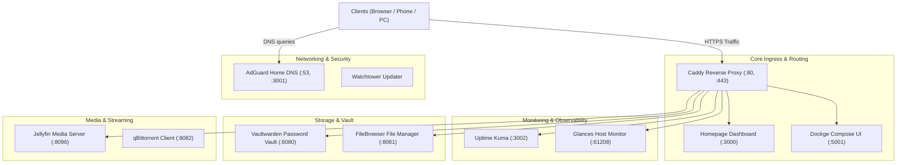

# 🏡 Personal Homelab Server

A modern, production-ready, lightweight Docker Compose homelab infrastructure tailored for Linux servers, virtual machines (Proxmox, Debian/Ubuntu), and Raspberry Pi devices.

---

## 📑 Table of Contents

- [Architecture Overview](#-architecture-overview)
- [Included Services & Ports](#-included-services--ports)
- [Repository Structure](#-repository-structure)
- [Quick Start Guide](#-quick-start-guide)
  - [Linux / Proxmox Server](#linux--proxmox-server)
  - [Windows / WSL2](#windows--wsl2)
- [Service Management](#-service-management)
- [Network & Reverse Proxy Configuration](#-network--reverse-proxy-configuration)
- [Backups & Disaster Recovery](#-backups--disaster-recovery)
- [Security Best Practices](#-security-best-practices)

---

## 🏛 Architecture Overview



---

## 📦 Included Services & Ports

| Service | Category | Default Port | Direct URL | Reverse Proxy Subdomain | Description |
| :--- | :--- | :--- | :--- | :--- | :--- |
| **Homepage** | Core | `3000` | `http://<ip>:3000` | `homepage.homelab.local` | Minimalist, real-time application dashboard |
| **Caddy** | Core | `80`, `443` | `http://<ip>:80` | `homelab.local` | Automatic SSL reverse proxy & router |
| **Dockge** | Core | `5001` | `http://<ip>:5001` | `dockge.homelab.local` | Reactive Docker Compose manager |
| **Watchtower** | Core | *None* | *Background* | *N/A* | Automated container update monitor |
| **AdGuard Home**| Network | `53`, `3001` | `http://<ip>:3001` | `adguard.homelab.local` | DNS ad-blocker & local DNS manager |
| **Uptime Kuma** | Monitoring | `3002` | `http://<ip>:3002` | `uptime.homelab.local` | Uptime & health check monitoring |
| **Glances** | Monitoring | `61208` | `http://<ip>:61208` | `glances.homelab.local` | Real-time system performance metrics |
| **Vaultwarden** | Storage | `8080` | `http://<ip>:8080` | `vault.homelab.local` | Self-hosted Bitwarden-compatible vault |
| **FileBrowser** | Storage | `8081` | `http://<ip>:8081` | `files.homelab.local` | Lightweight browser-based file explorer |
| **Jellyfin** | Media | `8096` | `http://<ip>:8096` | `media.homelab.local` | Open-source media streaming server |
| **qBittorrent** | Media | `8082` | `http://<ip>:8082` | `homelab.local:8082` | Web-based torrent client |

---

## 📂 Repository Structure

```
Personal Homelab Server/
├── .env.example                  # Environment template (ports, domain, paths)
├── docker-compose.yml            # Main compose orchestrator (includes all stacks)
├── Makefile                      # CLI shortcuts (make up, make down, etc.)
├── README.md                     # Documentation & setup guide
├── compose/                      # Modular stack definitions
│   ├── core.yml                  # Caddy, Homepage, Dockge, Watchtower
│   ├── network.yml               # AdGuard Home
│   ├── monitoring.yml            # Uptime Kuma, Glances
│   ├── storage.yml               # Vaultwarden, FileBrowser
│   └── media.yml                 # Jellyfin, qBittorrent
├── config/                       # Application configuration templates
│   ├── caddy/
│   │   └── Caddyfile             # Reverse proxy routing rules
│   ├── homepage/                 # Dashboard layout, bookmarks & services
│   │   ├── bookmarks.yaml
│   │   ├── services.yaml
│   │   ├── settings.yaml
│   │   └── widgets.yaml
│   └── filebrowser/
│       └── settings.json         # FileBrowser root & database setup
└── scripts/
    ├── setup.sh                  # Linux bootstrap script
    ├── setup.ps1                 # Windows PowerShell bootstrap script
    ├── manage.sh                 # Linux service management CLI
    ├── manage.ps1                # Windows service management CLI
    └── backup.sh                 # Automated backup script with rotation
```

---

## 🚀 Quick Start Guide

### Linux / Proxmox Server

1. **Clone or transfer the repository** to your server:
   ```bash
   cd "Personal Homelab Server"
   ```

2. **Run the bootstrap script**:
   ```bash
   bash scripts/setup.sh
   ```
   *This automatically generates `.env`, creates required data directories, and sets up the Docker bridge network.*

3. **Customize your settings**:
   Inspect `.env` and configure your timezone, host IP, or custom domain if needed:
   ```bash
   nano .env
   ```

4. **Start the homelab**:
   ```bash
   make up
   # OR
   docker compose up -d
   ```

5. **Access the Dashboard**:
   Open your browser and navigate to:
   ```
   http://<YOUR-SERVER-IP>:3000
   ```

---

### Windows / WSL2

1. Open PowerShell in the project directory:
   ```powershell
   cd "Personal Homelab Server"
   ```
2. Run setup:
   ```powershell
   .\scripts\setup.ps1
   ```
3. Start services:
   ```powershell
   docker compose up -d
   ```

---

## 🛠 Service Management

You can control all stacks together or individually using the provided helper script:

```bash
# Start all services
./scripts/manage.sh start all

# Start only a specific stack
./scripts/manage.sh start core
./scripts/manage.sh start monitoring
./scripts/manage.sh start media

# Stop a specific stack
./scripts/manage.sh stop media

# Check status of containers
./scripts/manage.sh ps

# View container logs
./scripts/manage.sh logs caddy

# Pull new images and update all running containers
./scripts/manage.sh update
```

Or using **Make**:
```bash
make up         # Start all
make down       # Stop all
make ps         # Container status
make logs       # Follow logs
make update     # Pull images & recreate
make backup     # Run backup
```

---

## 🌐 Network & Reverse Proxy Configuration

### Local Domain Resolution with AdGuard Home
To access services via local names (e.g. `homepage.homelab.local`, `vault.homelab.local`):
1. Log into **AdGuard Home** at `http://<SERVER_IP>:3001`.
2. Navigate to **Filters** → **DNS rewrites**.
3. Add a wildcard rewrite:
   - **Domain**: `*.homelab.local` (and `homelab.local`)
   - **IP address**: `<YOUR-SERVER-IP>`
4. Set your router's primary DNS or your device's DNS to `<YOUR-SERVER-IP>`.

---

## 💾 Backups & Disaster Recovery

The included backup script compresses persistent configs and databases into `backups/` while rotating old archives:

```bash
# Run manual backup
bash scripts/backup.sh
# OR
make backup
```

### Scheduling Backups (Cron)
To run a daily backup at 3:00 AM on Linux:
```bash
crontab -e
```
Add the following line:
```cron
0 3 * * * cd /path/to/Personal\ Homelab\ Server && bash scripts/backup.sh >/dev/null 2>&1
```

---

## 🔒 Security Best Practices

1. **Firewall (UFW)**: Only expose ports `80`, `443`, and `22` (SSH) externally. Keep administrative ports bound locally or accessible through a VPN.
2. **Tailscale / WireGuard**: For secure remote access outside your home network without opening public ports, install [Tailscale](https://tailscale.com/) on the host.
3. **Change Default Credentials**:
   - Set a strong `VAULTWARDEN_ADMIN_TOKEN` in `.env`.
   - Complete initial setup credentials on FileBrowser and AdGuard Home immediately upon first launch.
